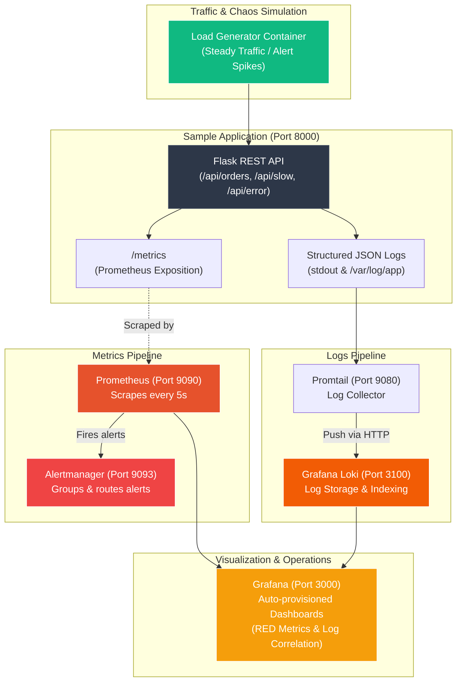

# Production-Ready Observability Stack as Code

[](https://github.com/SaiNanduVajhala/observabilty-stack/actions/workflows/ci.yml)
[](https://prometheus.io/)
[](https://grafana.com/)
[](https://grafana.com/oss/loki/)
[](https://docs.docker.com/compose/)

A self-contained, production-grade observability stack built with Docker Compose. Features automated provisioning, Prometheus metrics scraping, Loki log aggregation, Promtail log shipping, Alertmanager alerting, and automated Grafana dashboards—deployed entirely **as code** with zero manual configuration.

---

## Table of Contents
1. [Overview & Problem Statement](#overview--problem-statement)
2. [Architecture Diagram](#architecture-diagram)
3. [Stack Components & Endpoints](#stack-components--endpoints)
4. [Prerequisites](#prerequisites)
5. [Quick Start](#quick-start)
6. [Component Verification Walkthrough](#component-verification-walkthrough)
7. [Alerting & Demonstration Scenarios](#alerting--demonstration-scenarios)
8. [Dashboards Overview](#dashboards-overview)
9. [Design Decisions & Trade-offs](#design-decisions--trade-offs)
10. [Production Readiness Roadmap](#production-readiness-roadmap)
11. [Project Structure](#project-structure)

---

## Overview & Problem Statement

Modern microservices fail in complex, non-obvious ways. Without centralized telemetry, engineers face:
- **Blind spots**: Inability to identify latency spikes before customers report them.
- **Log sprawl**: Manually SSH-ing into containers or servers to grep unstructured log files.
- **Configuration drift**: Manually built Grafana dashboards and click-configured alert rules that are lost when an environment is rebuilt.

### The Solution
This project provides a **100% self-contained, reproducible observability stack as code**:
- **Application Instrumentation**: A Python REST API instrumented with the Prometheus client library and structured JSON logging.
- **Metrics Collection & Alerting**: Prometheus scrapes metrics on a 5s interval and evaluates alert rules as code (`TargetDown`, `HighErrorRate`, `HighP95Latency`).
- **Log Aggregation & Correlation**: Loki ingests structured logs shipped by Promtail. Grafana correlates log spikes directly with metrics.
- **Zero-Click Provisioning**: Grafana datasources and dashboards load automatically from git-tracked JSON/YAML files on startup.
- **Automated Validation**: GitHub Actions validates Compose configurations, `promtool` rules, `yamllint`, and dashboard syntax on every PR.

---

## Architecture Diagram



---

## Stack Components & Endpoints

| Service | Port | Internal URL | Credentials / Notes | Health Check URL |
| :--- | :--- | :--- | :--- | :--- |
| **Grafana** | `3000` | `http://grafana:3000` | `admin` / `admin` | `http://localhost:3000/api/health` |
| **Prometheus** | `9090` | `http://prometheus:9090` | No auth (Local dev) | `http://localhost:9090/-/healthy` |
| **Alertmanager** | `9093` | `http://alertmanager:9093` | Web UI & Webhooks | `http://localhost:9093/-/healthy` |
| **Loki** | `3100` | `http://loki:3100` | Log ingestion & query API | `http://localhost:3100/ready` |
| **Promtail** | `9080` | `http://promtail:9080` | Log shipper metrics/status | `http://localhost:9080/ready` |
| **Sample App** | `8000` | `http://sample-app:8000` | REST API + `/metrics` | `http://localhost:8000/health` |
| **Loadgen** | -- | `http://loadgen` | Simulates load & alert spikes | Docker health status |

---

## Prerequisites

- **Docker** and **Docker Compose v2+** installed and running
- **Git**
- *(Optional)* Python 3.11+ if running load tests or linting outside Docker

---

## Quick Start

### 1. Clone & Start the Stack
```bash
git clone https://github.com/SaiNanduVajhala/observabilty-stack.git
cd observabilty-stack

# Start all containers in the background
docker compose up --build -d
```

### 2. Verify Running Services
```bash
docker compose ps
```
All containers should display status `Up` or `healthy`.

### 3. Open Grafana
Navigate to [http://localhost:3000](http://localhost:3000) in your browser:
- **Username**: `admin`
- **Password**: `admin`
- Go to **Dashboards** > **Observability** folder to see preloaded dashboards.

---

## Component Verification Walkthrough

### 1. Sample App & Metrics
- Test API response:
  ```bash
  curl http://localhost:8000/health
  curl http://localhost:8000/
  ```
- Inspect Prometheus metrics output:
  ```bash
  curl http://localhost:8000/metrics
  ```
  *You should observe metrics including `http_requests_total`, `http_request_duration_seconds_bucket`, `ecommerce_orders_processed_total`, and `ecommerce_order_revenue_total`.*

### 2. Prometheus Targets & Queries
Open [http://localhost:9090/targets](http://localhost:9090/targets) to confirm `sample-app`, `prometheus`, `alertmanager`, and `loki` are all in `UP` state.

Try these PromQL expressions in [http://localhost:9090/graph](http://localhost:9090/graph):
```promql
# 1. Total request rate per second
sum(rate(http_requests_total[1m]))

# 2. 95th percentile latency in seconds
histogram_quantile(0.95, sum(rate(http_request_duration_seconds_bucket[1m])) by (le))

# 3. Total e-commerce order revenue
sum(ecommerce_order_revenue_total)
```

### 3. Loki & Promtail Log Verification
Open **Grafana Explore** at [http://localhost:3000/explore](http://localhost:3000/explore), select datasource **Loki**, and run:
```logql
# Stream all structured JSON logs from the application
{job=~"sample-app.*"} | json

# Filter for HTTP 500 error logs only
{job=~"sample-app.*"} | json | status_code >= 500
```

### 4. Alertmanager
Open [http://localhost:9093](http://localhost:9093) to view active alerts, silences, and notification groupings.

---

## Alerting & Demonstration Scenarios

The stack includes alert rules defined as code in `prometheus/alert.rules.yml`. The included load generator can automatically trigger each alert to demonstrate incident detection.

### Alert Rules Definition

| Alert Name | Condition (PromQL) | Duration | Severity | Action Trigger |
| :--- | :--- | :--- | :--- | :--- |
| **`TargetDown`** | `up{job="sample-app"} == 0` | `30s` | `CRITICAL` | App process stopped or crashing |
| **`HighErrorRate`** | `5xx_rate / total_rate * 100 > 10%` | `30s` | `CRITICAL` | Excessive 500 responses |
| **`HighP95Latency`** | `histogram_quantile(0.95) > 0.5s` | `30s` | `WARNING` | Slow responses exceeding 500ms |

### Triggering Alerts On Demand

#### Scenario A: Trigger `HighErrorRate` (>10% 5xx errors)
Run the load generator error spike scenario:
```bash
docker compose run --rm loadgen python loadgen.py --scenario error-spike
```
1. Open Prometheus Alerts at [http://localhost:9090/alerts](http://localhost:9090/alerts).
2. Watch `HighErrorRate` move from **Inactive** &rarr; **Pending** &rarr; **Firing**.
3. View the incoming alert in Alertmanager at [http://localhost:9093](http://localhost:9093).
4. Correlate with logs in Grafana: the "5xx Errors / sec" graph spikes and the "Filtered Error Logs" panel displays the simulated `DatabaseTimeoutException`.

#### Scenario B: Trigger `HighP95Latency` (p95 > 500ms)
Run the latency spike scenario:
```bash
docker compose run --rm loadgen python loadgen.py --scenario latency-spike
```
1. Watch `HighP95Latency` transition to **Firing** in Prometheus.
2. In Grafana RED dashboard, observe the p95 and p99 percentile lines climb over 1.0s.

#### Scenario C: Trigger `TargetDown`
Stop the sample app container:
```bash
docker compose stop sample-app
```
Within 30 seconds, `TargetDown` fires with `severity: critical`. Restart the service to resolve:
```bash
docker compose start sample-app
```

---

## Dashboards Overview

Dashboards are provisioned on container startup from `grafana/dashboards/`:

### 1. Application RED Metrics & KPIs (`red-metrics.json`)
Implements the **RED Method** (Rate, Errors, Duration):
- **Rate**: Request throughput per second across all endpoints.
- **Errors**: HTTP 5xx error percentage with alert thresholds.
- **Duration**: Latency percentiles (p50, p90, p95, p99) computed from histogram buckets.
- **Business KPIs**: Real-time order count by payment method and cumulative revenue.

```
+-----------------------------------------------------------------------+
| [Rate: 14.2 req/s]  [Errors: 0.0%]  [P95: 42ms]  [Revenue: $12,450]   |
+------------------------------------+----------------------------------+
| Request Rate by Endpoint (Line)    | Latency Percentiles (p50/p95/p99)|
+------------------------------------+----------------------------------+
| HTTP Status Codes (Stacked Bar)    | Orders by Payment Method (Bars)  |
+-----------------------------------------------------------------------+
```
*(Screenshot placeholder: `docs/images/red-dashboard.png`)*

### 2. Logs & Metrics Correlation Dashboard (`logs-correlation.json`)
Combines metrics and structured log streams in a unified interface:
- Correlates Prometheus HTTP request spikes with Loki log volume.
- Real-time filtered stream of application error stack traces.
- Live structured JSON application log stream.

*(Screenshot placeholder: `docs/images/logs-dashboard.png`)*

---

## Design Decisions & Trade-offs

### 1. Prometheus vs. OpenTelemetry Collector & Push-based systems
- **Decision**: Used Prometheus native pull model.
- **Rationale**: Pull-based scraping provides built-in health tracking (`up` metric) without requiring additional heartbeats. Target discovery is straightforward and local storage is efficient and self-contained.
- **Trade-off**: Requires network access to target endpoints. In ephemeral serverless environments (e.g. AWS Lambda), push-based solutions or OpenTelemetry Collector agents are more suitable.

### 2. Loki vs. Elasticsearch / OpenSearch
- **Decision**: Grafana Loki for log aggregation.
- **Rationale**: Loki indexes only metadata labels (like `job`, `service`, `level`), storing log chunks in raw compressed format. This consumes up to 80% less memory and disk space than Elasticsearch's full-text inverted indices, while seamlessly integrating with Grafana.
- **Trade-off**: Full-text queries without label filters require scanning log streams, making free-text search slower than Elasticsearch for massive non-partitioned datasets.

### 3. Promtail vs. Grafana Alloy
- **Decision**: Promtail log collector.
- **Rationale**: Lightweight, purpose-built, and well-understood for Docker container environments. Promtail reads structured logs and ships directly via Loki's push API.
- **Note**: Grafana Alloy is the newer OpenTelemetry-first collector successor to Promtail. Promtail was chosen here for simplicity and minimal footprint.

### 4. Zero-Click Provisioning (GitOps for Observability)
- **Decision**: 100% file-based provisioning for Grafana datasources, dashboards, Prometheus configs, and alert rules.
- **Rationale**: Eliminates manual UI drift. Entire environments can be wiped and re-created in seconds with `docker compose down -v && docker compose up -d`. Dashboards and alert rules are reviewed via standard GitHub pull requests.

---

## Production Readiness Roadmap

To transition this architecture to high-scale production:

1. **High Availability & Clustering**:
   - Run Prometheus in HA pairs with Thanos or Cortex for deduplication and long-term storage in S3/GCS.
   - Deploy Loki in microservices mode using MinIO or AWS S3 for object storage and BoltDB-shipper/TSDB index.
2. **Security & Authentication**:
   - Enable TLS/mTLS for scrape endpoints and Alertmanager webhooks.
   - Configure Grafana with OAuth/OIDC (Okta, GitHub, Google) or LDAP instead of admin credentials.
   - Restrict network policies so only Promtail can reach Loki and only Prometheus can scrape `/metrics`.
3. **Orchestration**:
   - Transition from Docker Compose to Kubernetes using the `kube-prometheus-stack` Helm chart and Prometheus Operator CRDs (`ServiceMonitor`, `PrometheusRule`).
4. **Log Retention & Archival**:
   - Configure automated retention policies in Loki compactor to delete chunks after 30–90 days.

---

## Project Structure

```
├── .github/
│   └── workflows/
│       └── ci.yml               # GitHub Actions validation pipeline
├── .gitignore
├── .yamllint.yml                # Yamllint configuration
├── docker-compose.yml           # Multi-service stack definition
├── README.md                    # Project documentation
├── app/
│   ├── app.py                   # Instrumented Flask application
│   ├── requirements.txt         # Python dependencies
│   └── Dockerfile               # Application container definition
├── prometheus/
│   ├── prometheus.yml           # Prometheus scrape configuration
│   └── alert.rules.yml          # Prometheus alert rules as code
├── alertmanager/
│   └── alertmanager.yml         # Alert routing & receivers configuration
├── loki/
│   └── loki-config.yml          # Loki single-binary storage configuration
├── promtail/
│   └── promtail-config.yml      # Promtail scrape & pipeline configuration
├── grafana/
│   ├── provisioning/
│   │   ├── datasources/
│   │   │   └── datasources.yml  # Auto-provisioned datasources (Prometheus & Loki)
│   │   └── dashboards/
│   │       └── dashboards.yml   # Auto-provisioned dashboard providers
│   └── dashboards/
│       ├── red-metrics.json     # RED method & Business metrics dashboard
│       └── logs-correlation.json # Logs & Metrics correlation dashboard
├── loadgen/
│   ├── loadgen.py               # Traffic & alert spike generator
│   └── Dockerfile               # Load generator container definition
└── docs/
    ├── promql-logql-guide.md    # Detailed guide to PromQL and LogQL queries
    └── runbooks.md              # Incident runbooks for active alerts
```

---

## License & Contributing
MIT License. Pull requests and feedback are welcome!
